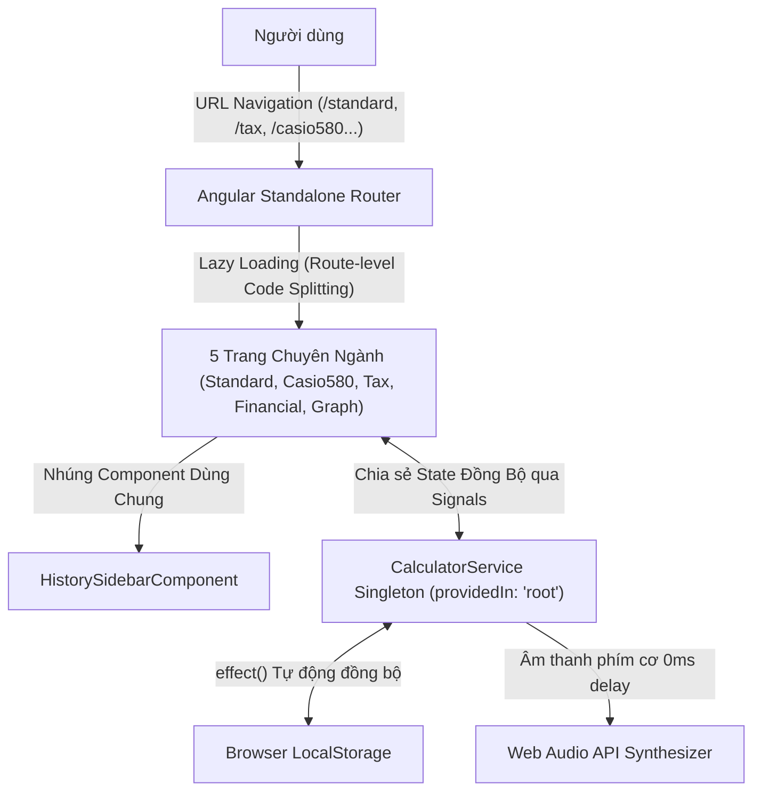

# OmniCalc - Máy tính cá nhân online

> **Báo cáo Đồ án Chuyên ngành Công nghệ Thông tin / Kỹ thuật Phần mềm**  
> **Kiến trúc:** MVVM (Model - View - ViewModel) & Page-Based Routing (Angular Standalone Routes)  
> **Nền tảng:** Angular v17+ (Signals, Lazy-loaded Routes, Component Composition) & SCSS  
> **Hệ thống 5 Trang Độc Lập:** Tiêu Chuẩn (`/standard`), Casio fx-580VN X (`/casio580`), Thuế TNCN (`/tax`), Kế Toán (`/financial`), Đồ Thị 2D (`/graph`)  
> **Trạng thái triển khai:** Ứng dụng Angular prerender tĩnh, không cần backend
> **Live Demo:** [Mở OmniCalc](https://khoartyu.github.io/omni-calc/)

---

## 📌 1. Giới Thiệu Tổng Quan Đồ Án

**OmniCalc** là máy tính cá nhân online, tập hợp các công cụ tính toán thường dùng trong một không gian riêng tư trên trình duyệt. Lịch sử, công thức và tùy chọn được lưu trên thiết bị; ứng dụng không cần tài khoản hay backend. Người dùng có thể chuyển giữa các chế độ tiêu chuẩn, khoa học, thuế, tài chính và đồ thị.

Ứng dụng chia thành 5 trang chuyên biệt:
1. **Trang Máy Tính Tiêu Chuẩn (`/standard`):** Tính toán đại số cơ bản hàng ngày, sửa sai số thực **IEEE 754** (`0.1 + 0.2 = 0.3`), chống chia cho 0, bộ nhớ đệm M+/M-/MR/MC.
2. **Trang Casio fx-580VN X (`/casio580`):** Máy tính khoa học cho Học sinh - Sinh viên với màn hình LCD ClassWiz, 20 phím hàm lượng giác, căn bậc, lũy thừa, logarit, giai thừa $n!$, chuyển đổi góc DEG/RAD.
3. **Trang Tính Thuế TNCN Việt Nam (`/tax`):** Động cơ tính thuế theo Luật Thuế TNCN hiện hành với biểu lũy tiến 7 bậc, tự động trừ gia cảnh bản thân (11M), người phụ thuộc (4.4M/người) và BHXH/BHYT (10.5%).
4. **Trang Kế Toán & Tài Chính (`/financial`):** Nghiệp vụ tính thuế GTGT (VAT: 5%, 8%, 10%) và công thức Lãi kép tích lũy gửi tiết kiệm $A = P(1 + r/n)^{nt}$.
5. **Trang Đồ Thị Hàm Số 2D (`/graph`):** Dựng hệ trục toạ độ Oxy và vẽ đường cong hàm số đại số liên tục trên **HTML5 Canvas 2D**.

---

## 🏛️ 2. Phân Tích Kiến Trúc Routing & Tối Ưu Hóa Hiệu Năng



### 2.1. Kỹ thuật Lazy Loading & Route-level Code Splitting
- Dự án áp dụng `loadComponent: () => import(...)` trong `src/app/app.routes.ts`.
- **Lợi ích học thuật:** Thay vì đóng gói toàn bộ mã nguồn vào một file bundle khổng lồ, Angular Compiler tự động tách từng trang thành các chunk độc lập (`casio580-component.js`, `tax-component.js`, v.v.). Khi người dùng truy cập trang nào, trình duyệt mới tải chunk đó về, giúp giảm kích thước gói tải ban đầu và tối ưu chỉ số **First Contentful Paint (FCP)**.

### 2.2. Tính Bền Vững Trạng Thái (State Persistence across Routes)
- Mặc dù được chia thành 5 trang riêng biệt, toàn bộ dữ liệu lịch sử tính toán, trạng thái bộ nhớ đệm, đơn vị đo góc và âm thanh phím bấm được quản lý bởi **CalculatorService Singleton** (`providedIn: 'root'`).
- Khi người dùng tính toán ở trang `/standard` rồi chuyển sang trang `/tax` hay `/casio580`, lịch sử và cài đặt vẫn được bảo toàn nguyên vẹn mà không bị reset.

---

## 📁 3. Cấu Trúc Thư Mục Dự Án (Tree Structure)

```
omni-calc/
├── src/
│   ├── app/
│   │   ├── pages/                               # CÁC TRANG CHUYÊN NGÀNH RIÊNG BIỆT
│   │   │   ├── standard/                        # Trang 1: Máy tính tiêu chuẩn (/standard)
│   │   │   │   ├── standard.component.ts
│   │   │   │   ├── standard.component.html
│   │   │   │   └── standard.component.scss
│   │   │   ├── casio580/                        # Trang 2: Casio fx-580VN X (/casio580)
│   │   │   │   ├── casio580.component.ts
│   │   │   │   ├── casio580.component.html
│   │   │   │   └── casio580.component.scss
│   │   │   ├── tax/                             # Trang 3: Thuế TNCN Việt Nam (/tax)
│   │   │   │   ├── tax.component.ts
│   │   │   │   ├── tax.component.html
│   │   │   │   └── tax.component.scss
│   │   │   ├── financial/                       # Trang 4: Kế toán VAT & Lãi kép (/financial)
│   │   │   │   ├── financial.component.ts
│   │   │   │   ├── financial.component.html
│   │   │   │   └── financial.component.scss
│   │   │   └── graph/                           # Trang 5: Đồ thị hàm số 2D Canvas (/graph)
│   │   │       ├── graph.component.ts
│   │   │       ├── graph.component.html
│   │   │       └── graph.component.scss
│   │   ├── components/                          # THÀNH PHẦN TÁI SỬ DỤNG
│   │   │   └── history-sidebar/                 # Component Lịch sử & Xuất CSV dùng chung
│   │   │       ├── history-sidebar.component.ts
│   │   │       ├── history-sidebar.component.html
│   │   │       └── history-sidebar.component.scss
│   │   ├── models/
│   │   │   └── calculation.model.ts             # Schema Model (TaxResult, Financial, Operator)
│   │   ├── services/
│   │   │   └── calculator.service.ts            # ViewModel Kernel (Signals, Math Engine, Audio API)
│   │   ├── app.ts                               # Root Shell (RouterOutlet & Pill Bar)
│   │   ├── app.html                             # Layout tổng thể & Modal báo cáo kỹ thuật
│   │   ├── app.scss                             # Style Layout & Navigation Bar
│   │   ├── app.routes.ts                        # Cấu hình 5 Standalone Lazy-loaded Routes
│   │   └── app.config.ts                        # Khởi tạo Angular Router & Hydration
│   ├── main.ts                                  # Entry point
│   └── styles.scss                              # Global Reset & Typography
├── angular.json                                 # Cấu hình Angular CLI
└── README.md                                    # Tài liệu bảo vệ đồ án chính thức
```

---

## 🚀 4. Hướng Dẫn Cài Đặt & Chạy Dự Án

```bash
# 1. Cài đặt thư viện
npm install

# 2. Khởi chạy máy chủ phát triển
npm start

# 3. Biên dịch xuất bản Static Web App
npm run build
```

Các đường dẫn truy cập trực tiếp:
- **`http://localhost:4200/standard`**: Máy tính Tiêu chuẩn
- **`http://localhost:4200/casio580`**: Máy tính Khoa học Casio 580
- **`http://localhost:4200/tax`**: Tính Thuế TNCN
- **`http://localhost:4200/financial`**: Kế toán & Tài chính
- **`http://localhost:4200/graph`**: Đồ thị Hàm số 2D

---

## 🎓 5. Sổ Tay Vấn Đáp Đồ Án Trước Hội Đồng (Defense Cheatsheet)

### **Câu 1: Tại sao em lại tách các phân hệ thành các trang riêng biệt thay vì dồn vào một Component?**
> **Trả lời:**  
> 1. **Tuân thủ kiến trúc SPA chuẩn mực:** Người dùng có thể bookmark và truy cập thẳng vào trang nghiệp vụ mình cần (ví dụ kế toán viên vào thẳng `/financial`, người đi làm vào thẳng `/tax`).  
> 2. **Tối ưu hiệu năng nạp trang qua Lazy Loading:** Áp dụng `loadComponent` giúp chia nhỏ bundle size (Route-level Code Splitting), trình duyệt chỉ tải trang nào khi người dùng thực sự kích hoạt.  
> 3. **Tái sử dụng Component (DRY):** Thanh lịch sử tính toán `HistorySidebarComponent` được thiết kế dùng chung cho cả 5 trang, kết hợp với Service Singleton giúp dữ liệu không bị gián đoạn khi chuyển trang.

---

*Đồ án hoàn thành bởi sinh viên ngành Công nghệ Thông tin - Chuyên ngành Kỹ thuật Phần mềm.*
